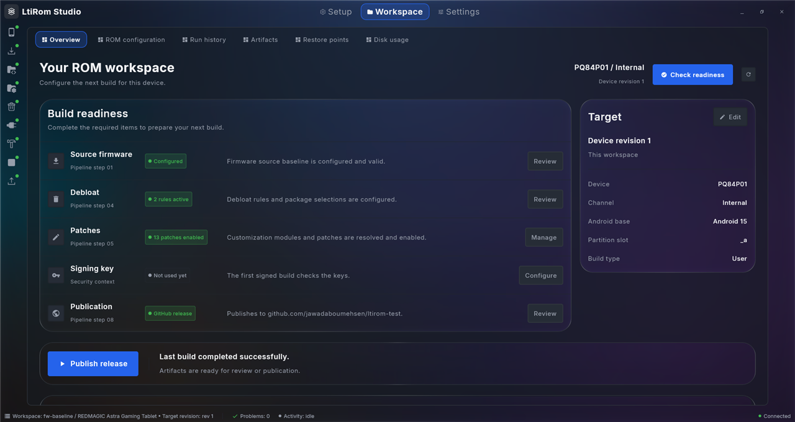
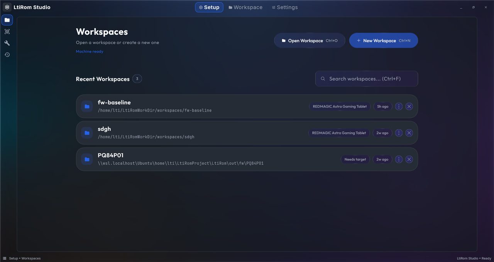
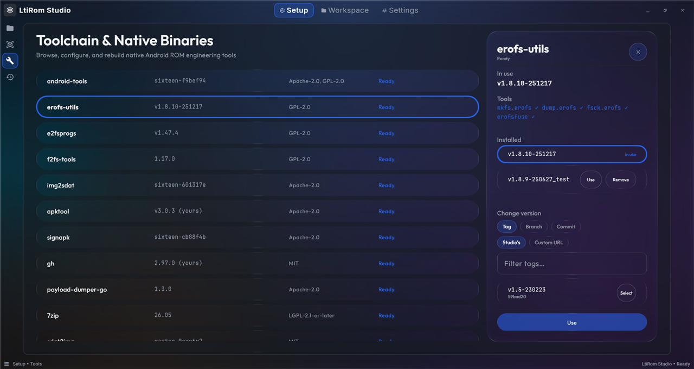
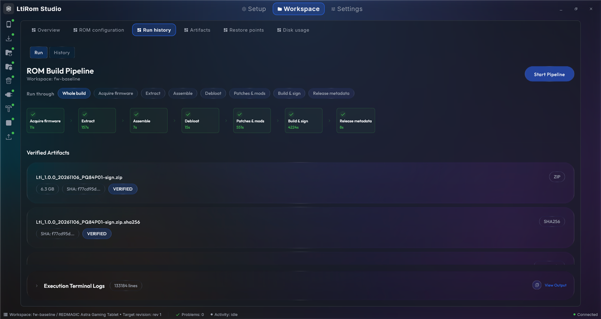
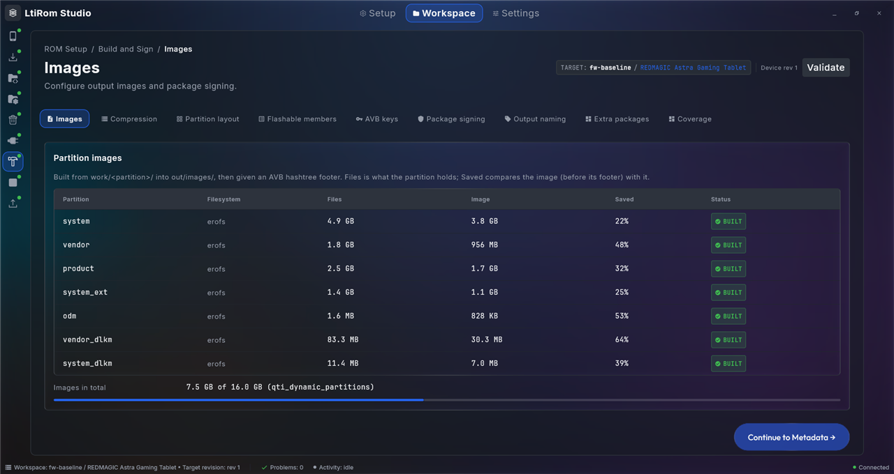
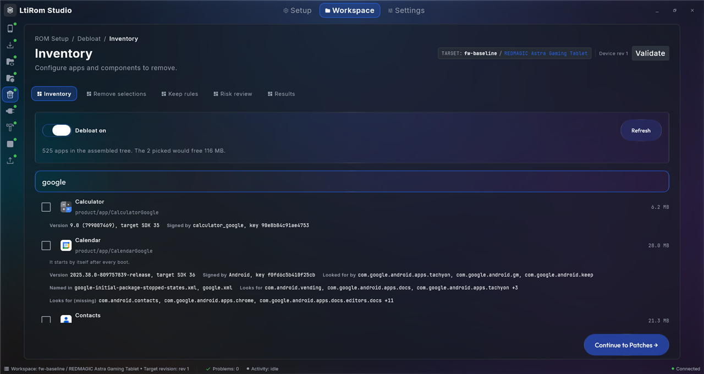
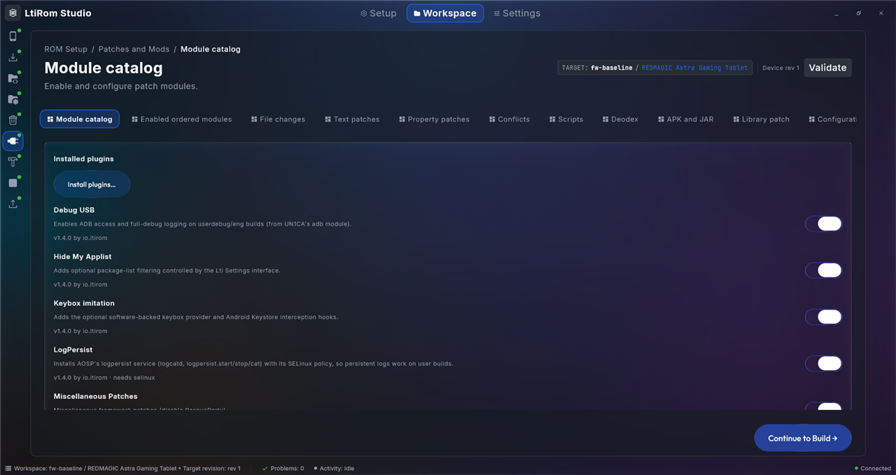

<div align="center">

# LtiRom Studio

**Build custom Android ROMs from stock firmware, in one desktop app.**

Import the firmware, choose what to remove and patch, and get a signed flashable zip or A/B OTA.
Every step runs for real in WSL Ubuntu, and you can see and check each one.


[](LICENSE)



</div>

## Contents

- [Why LtiRom Studio](#why-ltirom-studio)
- [A tour of the app](#a-tour-of-the-app)
- [The ROM pipeline](#the-rom-pipeline)
- [Design and user experience](#design-and-user-experience)
- [Getting started](#getting-started)
- [Project layout](#project-layout)
- [Quality checks](#quality-checks)

## Why LtiRom Studio

Building a ROM by hand means juggling dozens of tools, unpacking images, editing files without breaking a single
permission line, and hoping the result boots. LtiRom Studio turns that into a guided workflow:

- **One place for the whole build:** from the stock firmware archive to the signed package and the release.
- **Nothing is faked:** progress, sizes, hashes and app lists come from the real files in your workspace. If a
  step has not run yet, the screen says which stage produces it.
- **Safe by default:** the build refuses a tree that would not boot (missing permissions or SELinux labels, broken
  links, an unsigned app, a full super partition) and tells you why, in plain words.
- **Undo is built in:** removed apps and replaced files are backed up as restore points.
- **No secrets stored:** packages you lack are shown as one command to run in your own terminal. The app never asks
  for your password.

> [!IMPORTANT]
> The package never contains firmware images (radio, bootloader) or vbmeta. Flashing the result is up to you.

## A tour of the app

### Setup: from a clean machine to a working toolchain

Setup checks WSL, installs the bundled build service and builds every tool side by side (android-tools, erofs-utils,
f2fs-tools, apktool, signapk, gh, payload-dumper-go and more). You can pin any tool to a tag, branch or commit, or to
your own fork.

| Workspaces | Tools and versions |
|---|---|
|  |  |

### The Studio: one stage at a time

Each workspace opens in the Studio. The rail on the left shows the eight stages. A stage opens once everything before
it is valid, and the status bar always shows the workspace, open problems and current activity.

| Run the pipeline | Build & Sign |
|---|---|
|  |  |

| Debloat with app details | Patches and mods |
|---|---|
|  |  |

## The ROM pipeline

| # | Stage | What it does |
|---|---|---|
| 1 | **Acquire** | Downloads or imports the stock firmware and checks its SHA-256 |
| 2 | **Extract** | Unpacks zip, 7z, tar, payload.bin, block OTA, sparse and Odin firmware, then mounts or dumps the EROFS, ext4 and F2FS images |
| 3 | **Assemble** | Builds the work tree, boot images, mount tables and build properties |
| 4 | **Debloat** | Removes the apps you pick, after checking what the device still needs; backups can be restored |
| 5 | **Patches / Mods** | Applies installed mods (Kotlin SDK plugins) and project scripts |
| 6 | **Build & Sign** | Builds the partition images and super, signs the boot chain, writes the flashable zip and/or A/B OTA |
| 7 | **Release Metadata** | Writes the OTA manifest |
| 8 | **Publish** | Exports locally or publishes a GitHub release, after you confirm |

Each stage is cached by its inputs, so an unchanged stage is skipped on the next run, and a run can stop after any
stage ("Run through"). The **toolkit** adds boot image unpack and repack, kernel facts, an image and archive browser,
tree and code compare, a device-vs-firmware check, permission and label coverage, and restore points.

## Design and user experience

LtiRom Studio is built like a professional IDE: dense where you work, calm everywhere else.

- **Glass design system.** Window chrome, rails and controls use real blur and refraction (the vendored
  [Haze](https://github.com/chrisbanes/haze) library). Long content stays on readable, solid surfaces.
- **Themes and accents.** Blue Glass, Dark and Light, six accent colours, Comfortable or Compact density, and text
  at 100, 110 or 125%. A live preview shows each change before you leave Settings.
- **Accessible by rule.** Text colours are checked against WCAG AA contrast in tests, every focusable control has a
  visible focus ring, and turning off "Fluid animations" snaps motion instead of playing it.
- **Clear feedback.** Mistakes are shown next to the field that caused them ("A commit is 40 hex characters"),
  locked stages say what to finish first, and outward actions (publishing, deleting) always ask first.
- **Keyboard friendly.** `Ctrl+O` opens a workspace, `Ctrl+N` creates one, `Ctrl+F` searches, and `Esc` closes
  panels.
- **One source of truth for style.** Colours, spacing, sizes, opacity and motion are design tokens. Lint rules and a
  Gradle guardrail reject raw values in feature code, so the app stays consistent as it grows.

## Getting started

### Requirements

- Windows 11 with WSL 2 and an Ubuntu LTS distribution
- JDK 21 to build the app
- `LtiRomServer` checked out next to this repository (it is included as a
  composite build):

  ```text
  LtiRomProject/
  ├── LtiRomGui/      (this repository)
  └── LtiRomServer/   (build service that runs inside WSL)
  ```

### Build and run

```bash
./gradlew :lti-desktop:run
```

This also builds the bundled build service. Installers come from the `package*` tasks of `:lti-desktop`.

### First build

1. **Setup:** let the check finish. If packages are missing, run the shown command in your terminal and press
   "I've run it, check again".
2. **New workspace:** pick a device template.
3. **Acquire:** import your stock firmware archive.
4. **Run:** open Run history, choose "Whole build" (or stop after a stage) and press Start Pipeline.
5. Find the package and its SHA-256 under **Artifacts**.

## Project layout

| Path | Contents |
|---|---|
| `core/` | `model`, `domain` (pipeline, stages, workbenches), `data`, `datastore`, `ui`, `designsystem` (glass theme on vendored Haze) |
| `feature/` | `setup`, `workspace-*`, `configuration`, `plugins`, `settings`, and `rom-studio/` (the shell and one module per stage) |
| `sdk/` | `patch-mod` (the mod SDK and `patchmod` CLI), `patch-mod-runtime`, `patch-mod-hooks` |
| `lti-desktop/`, `lti-shared/` | The desktop app |
| `tool/`, `detekt-rules/`, `build-logic/` | Tooling, custom lint rules and Gradle conventions |

First-party mods live in a separate repository, [LtiRomMods](https://github.com/jawadaboumehsen/LtiRomMods).

## Quality checks

The pre-push hook runs these, and they must pass before a push:

```bash
./gradlew detekt verifyDesignSystemGuardrails checkArchitecture --continue
```

Tests: `./gradlew :core:domain:desktopTest` (and the matching task of each module you change).

Contributor notes on architecture, the design system and each pipeline stage are in [CLAUDE.md](CLAUDE.md).

## License

[Mozilla Public License 2.0](LICENSE).
