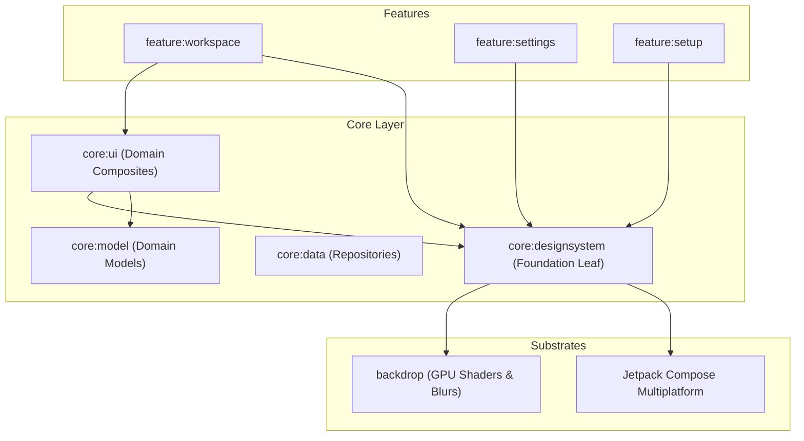

# `core:designsystem` Module Architecture

The `core:designsystem` module is the autonomous design foundation of LtiRom Studio. It provides pure, domain-agnostic UI tokens, atomic components, and layout scaffolding built on Liquid Glass morphism and Material 3.

---

## 1. Clean Architecture & Dependency Rules

In Clean Architecture, `core:designsystem` is an **independent leaf module** in the `:core` layer. It has **zero dependencies** on business domain logic, data persistence, or feature modules.



### Strict Modularization Guardrails:
- ❌ **NEVER** add dependencies from `core:designsystem` to `core:model`, `core:data`, `core:domain`, `core:network`, or any `feature:*`.
- ❌ **NEVER** import domain models (`FileNode`, `MessageRole`, `TerminalCommand`) into `core:designsystem`.
- ✅ **DO** build domain-bound composite widgets (`GlassCodeEditor`, `GlassFileTree`, `GlassChatInput`) inside `core:ui`.
- ✅ **DO** keep `core:designsystem` strictly focused on reusable, stateless UI primitives, design tokens, and layout scaffolds.

---

## 2. Domain-Driven Package Architecture

The 33 component files are structured into 8 functional domain packages following the Single Responsibility Principle:

```
org.ide.lti.core.designsystem.component
├── primitives/     # GlassSurface, GlassModifiers (Layer 1 foundations)
├── actions/        # GlassButton, GlassIconButton, GlassActionCard, WindowControls
├── inputs/         # GlassTextField, GlassSlider, GlassToggle
├── display/        # GlassCard, GlassPanel, GlassChip, GlassEmptyState, GlassListTile, GlassIcon, GlassDivider
├── navigation/     # GlassTabBar, GlassScrollableTabRow, GlassBottomTabs, GlassSidePanelTabs, GlassSidebarItem, GlassNavigation
├── layout/         # GlassLayout, GlassLayoutState, GlassDragDivider, GlassLayoutPanels, GlassTopBar, GlassStatusBar, CosmicAuroraBackdrop
├── feedback/       # GlassDialog, GlassBottomSheet, GlassScrollEdge
└── devtools/       # GlassPerformanceMonitor
```

### Clean Architecture Sealed Interfaces & Cohesive Data Classes
All components use strongly-typed models to enforce strict compile-time safety and eliminate parameter bloat:
- **`GlassTopBar`**:
  - `sealed interface TopBarNavigation` (`None`, `Back(onClick)`, `Menu(onClick)`, `Brand(title, workspaceName, onClick)`, `Custom(content)`).
  - `@Immutable data class TopBarPanelToggles` (`isLeftVisible`, `isRightVisible`, `isBottomVisible`, `onToggleLeft`, `onToggleRight`, `onToggleBottom`).
  - `@Immutable data class TopBarSearch` (`placeholder`, `shortcut`, `onClick`).
- **`GlassButton`**:
  - `sealed interface GlassButtonStyle` (`Primary`, `Secondary`, `Standard`, `Text`, `Custom(surfaceColor, contentColor, borderColor)`).
- **`GlassEmptyState`**:
  - `sealed interface EmptyStateAction` (`None`, `Single(label, onClick)`, `Dual(primaryLabel, onPrimaryClick, secondaryLabel, onSecondaryClick)`, `Custom(content)`).
- **`GlassDialog`**:
  - `sealed interface DialogActions` (`Single(confirmText, onConfirm)`, `ConfirmDismiss(confirmText, onConfirm, dismissText, onDismiss)`, `Custom(content)`).
- **`GlassChip`**:
  - `sealed interface ChipMode` (`Toggle(selected, onToggle)`, `Action(onClick)`, `ReadOnly`).

---

## 3. SOLID Principles in Practice

1. **Single Responsibility Principle (SRP)**:
   - Components and layouts are separated by role into 8 explicit domain packages: primitives, actions, inputs, display, navigation, layout, feedback, and devtools.
2. **Open/Closed Principle (OCP)**:
   - Components provide companion `*Defaults` objects (`GlassButtonDefaults`, `LtiLayoutDefaults`) and open composable slots (`leadingIcon`, `trailingIcon`, `actions`), enabling consumers to customize appearance without editing internals.
3. **Liskov Substitution Principle (LSP)**:
   - All glass containers derive from `GlassSurface`, guaranteeing identical backdrop refraction, squircle clipping, and `LocalContentColor` resolution across the entire component tree.
4. **Interface Segregation Principle (ISP)**:
   - Cohesive data classes and sealed interfaces (`TopBarPanelToggles`, `TopBarNavigation`, `TopBarSearch`) decouple components so callers only pass what they need, eliminating giant parameter lists.
5. **Dependency Inversion Principle (DIP)**:
   - Leaf `core:designsystem` exposes pure UI abstractions without any knowledge of domain/data/feature logic; features depend on `core:designsystem` rather than the reverse.